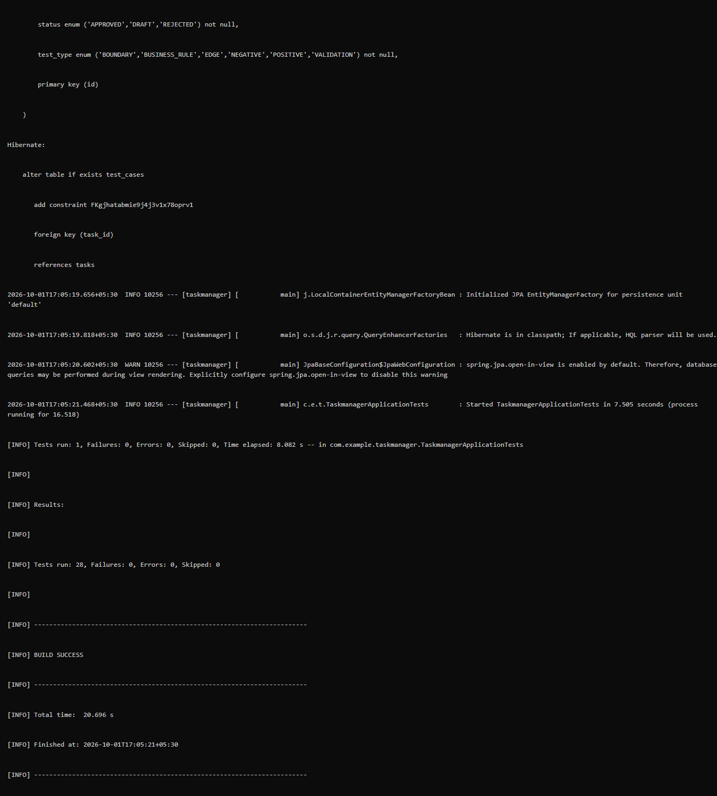
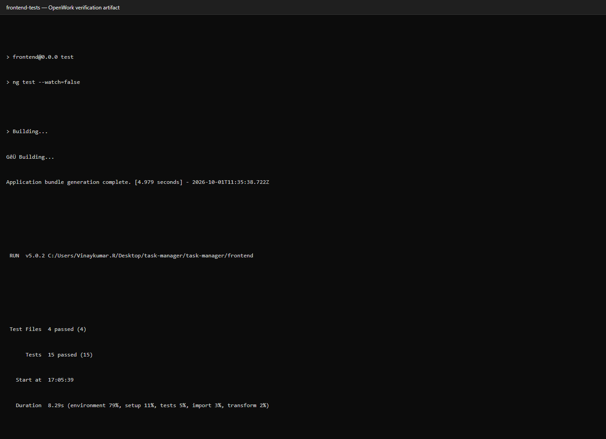
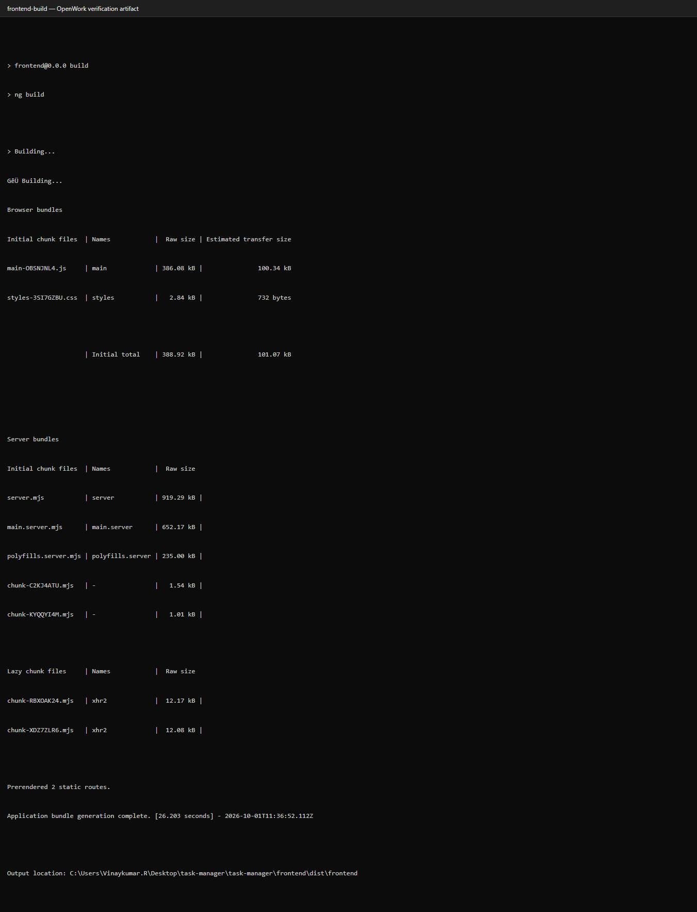
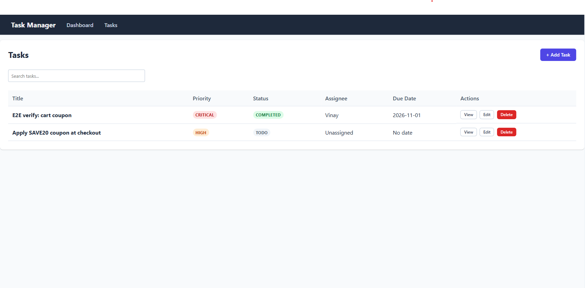
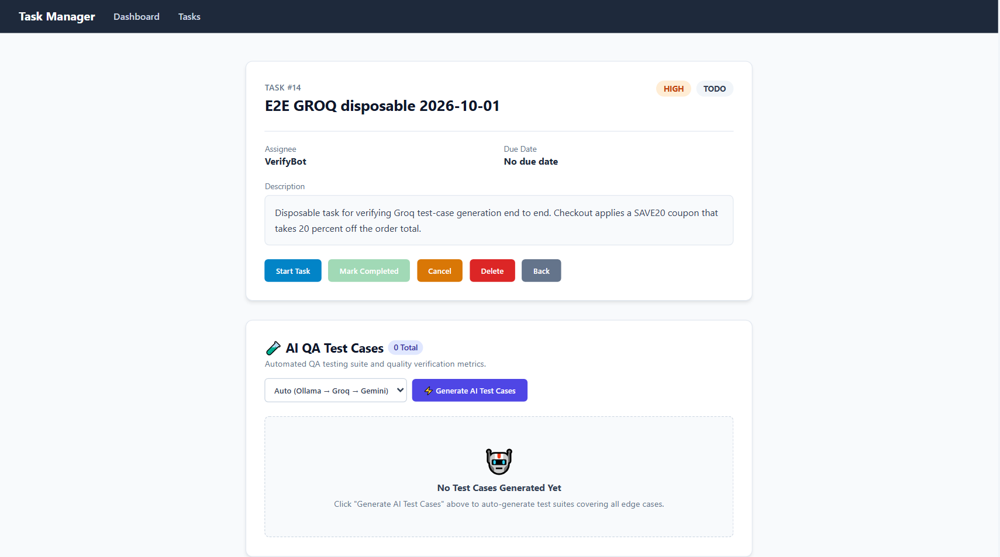
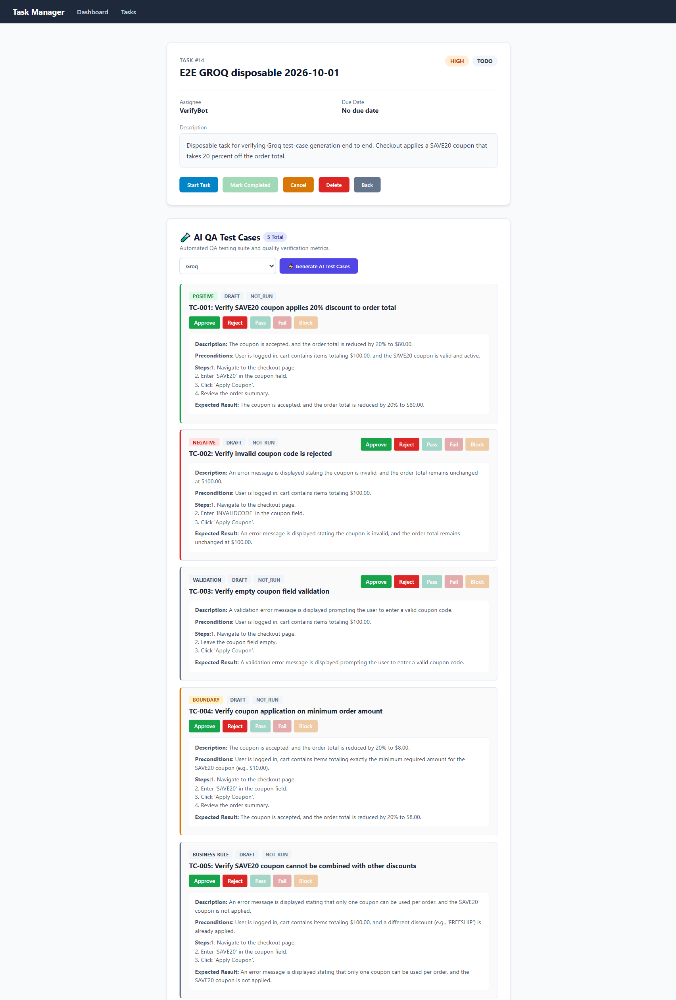
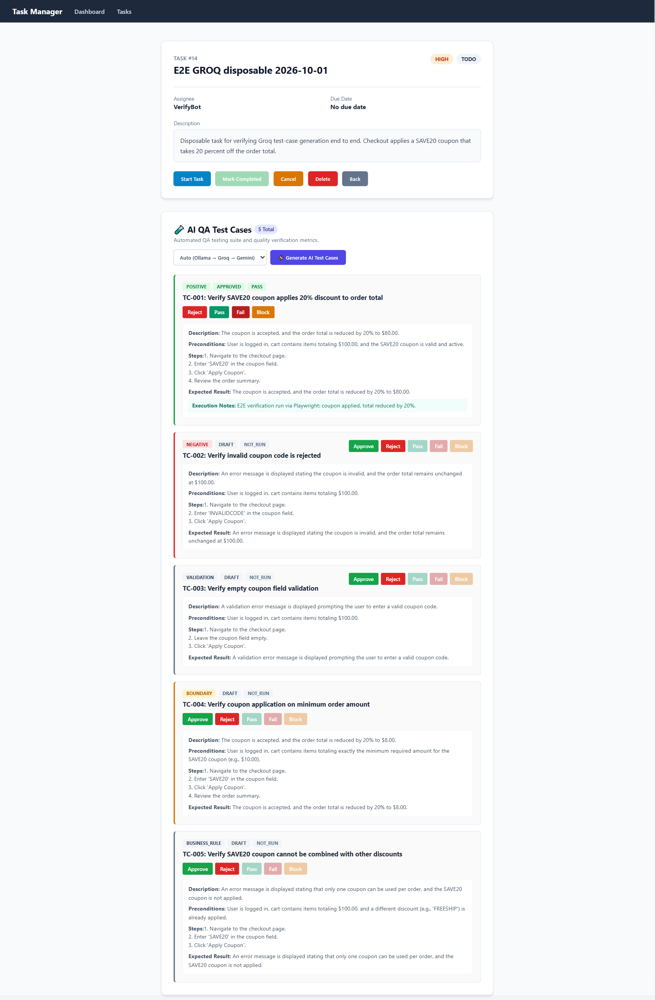
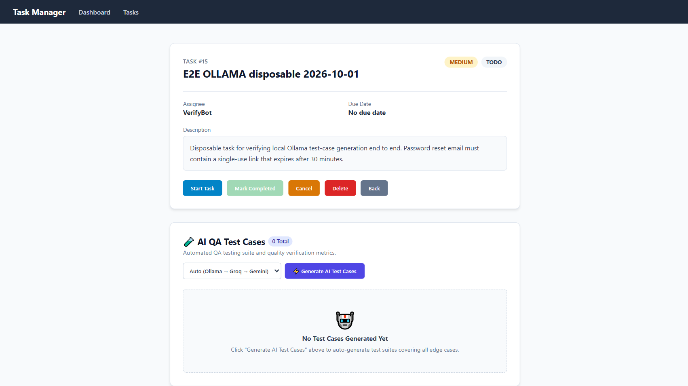
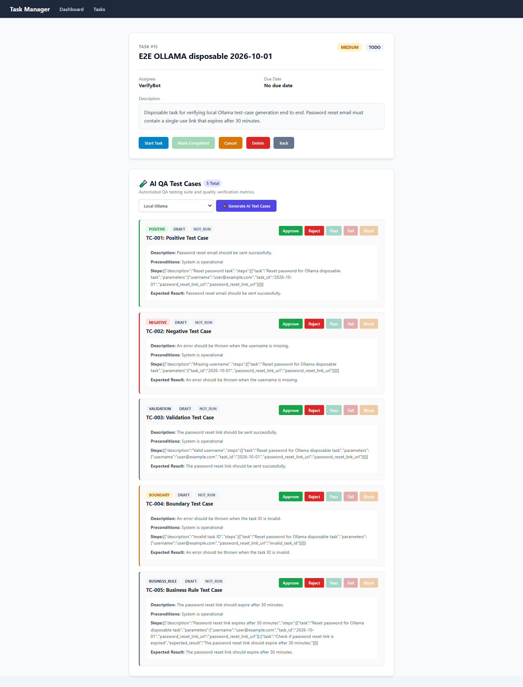
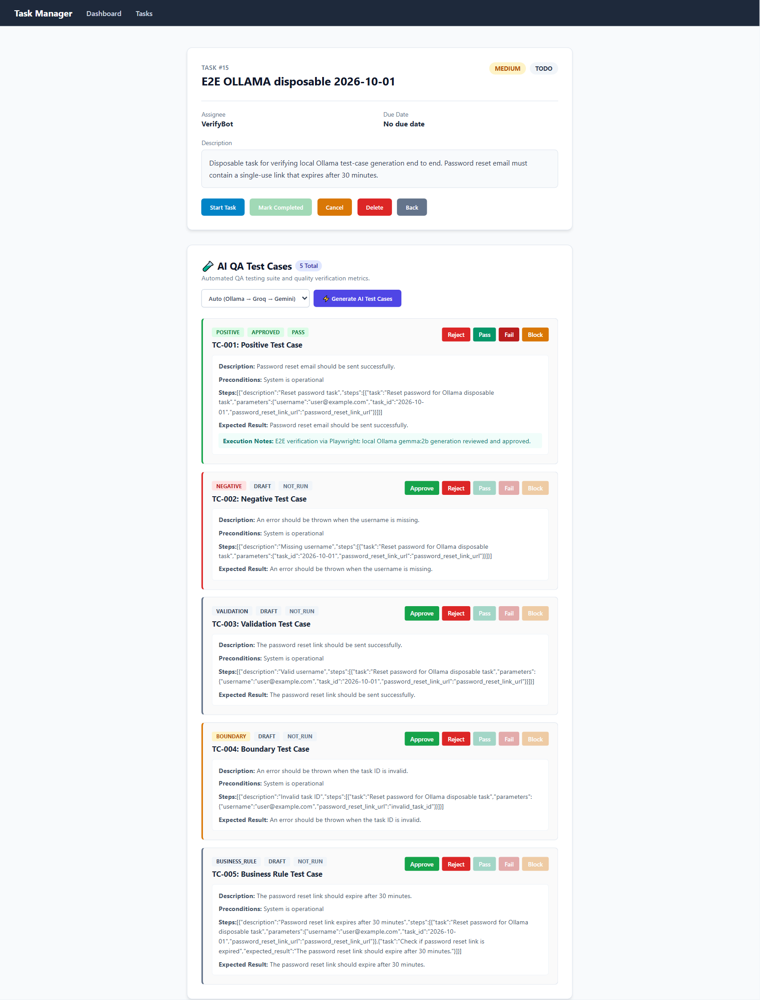

# Task Manager — Project Report

**Scope:** Architecture, configuration, workflow, and verification evidence for the Task Manager application.
**Report date:** 1 October 2026
**Verified against:** repository contents at commit working tree (uncommitted changes present; no commit made)

---

## 1. Executive summary

Task Manager is a web application for tracking work items that couples a conventional task tracker with an AI-assisted QA drafting feature. A user records a task — title, description, priority, assignee, due date — and then asks a large language model to draft a test-case suite for it. The generated cases are treated as proposals rather than results: they enter a `DRAFT` state, require explicit human approval, and only then can be executed and scored.

That review gate is the design centre of the project. Model output is never trusted to flow directly into a recorded result. The enforced sequence is:

```
LLM draft  →  DRAFT  →  (human review)  →  APPROVED  →  (execution)  →  PASS | FAIL
```

`TestCaseServiceImpl.executeTestCase()` throws when a case is not `APPROVED`, which makes the gate a server-side rule rather than a UI convention. This matters because the frontend is a browser client: any client-side-only guarantee could be bypassed by a direct API call.

**Verification outcome.** The backend and frontend both build and pass their automated suites. Two LLM providers — Groq and local Ollama — were exercised manually through the browser UI against a live database, each producing exactly five correctly-typed test cases that persisted across a page reload and advanced through approval and execution. One provider, Gemini, could not be validated because its free-tier quota was exhausted. Two functional defects and one output-quality gap were observed and are documented in section 7; none has been fixed, as this report is documentation-only.

---

## 2. Project purpose

### Problem addressed

Writing a first-pass QA suite for a feature is slow and inconsistent. The engineer must translate a task description into five categories of test — happy path, negative path, validation, boundary, and business rule — and write each one out by hand. This is repetitive work that a language model can perform quickly, provided its output is reviewed rather than trusted.

Task Manager does not attempt to replace test automation or execute tests. Its scope is deliberately narrow: **draft** cases, then track them through a review lifecycle. It produces proposals, not verdicts.

### Intended users

Quality-assurance engineers and developers who need a structured starting point for a new feature's test coverage. The approval gate assumes a human with enough context to judge whether a proposed case is meaningful.

### Scope boundaries

The application does not generate test code, integrate with a CI pipeline, or connect to a live system under test. Execution records a human-supplied verdict — the "execute" action captures a human decision, it does not run anything.

---

## 3. Architecture and technology stack

### 3.1 System shape

A three-tier application with an additional outbound dependency on external model providers.

```
┌──────────────────────────────────────────────────────────────┐
│ Browser                                                       │
│ Angular 22 SPA, SSR enabled              localhost:4201       │
│ Routes: /dashboard /tasks /tasks/new /tasks/:id /tasks/:id/edit│
└───────────────────────────┬──────────────────────────────────┘
                            │ JSON over HTTP, CORS
                            │ Absolute URLs — no dev proxy
                            ▼
┌──────────────────────────────────────────────────────────────┐
│ Spring Boot 4.1.1 / Java 21                localhost:8081      │
│                                                              │
│ TaskController       /api/tasks                              │
│ TestCaseController   /api/testcases                          │
│ TaskServiceImpl      CRUD + status business rules             │
│ TestCaseServiceImpl  prompt build, provider calls, parsing   │
│ RestTemplate         connect 5 s, read 300 s                  │
│ GlobalExceptionHandler  → JSON {"error": "..."}              │
└──────────┬──────────────────────────────┬────────────────────┘
           │ JPA / Hibernate               │ HTTPS outbound
           │ ddl-auto=update               ▼
┌────────────────────┐        ┌─────────────────────────────────┐
│ PostgreSQL 5433    │        │ LLM providers                   │
│ taskmanagement_db  │        │ Ollama  local, OpenAI-compatible│
│ user: postgres     │        │ Groq    OpenAI-compatible       │
└────────────────────┘        │ Gemini  native REST             │
                              └─────────────────────────────────┘
```

### 3.2 Backend

| Component | Version | Role |
|---|---|---|
| Spring Boot | 4.1.1 | Application framework (from `pom.xml` parent) |
| Java | 21 | Language level (`java.version`) |
| `spring-boot-starter-webmvc` | managed | REST controllers, JSON binding |
| `spring-boot-starter-data-jpa` | managed | Persistence, `TaskRepository`, `TestCaseRepository` |
| `spring-boot-starter-validation` | managed | Bean Validation on request DTOs |
| `postgresql` | managed | JDBC driver |
| `jackson-databind` | managed | LLM response parsing |
| `lombok` | managed | Compile-time boilerplate reduction |
| `h2` | managed | Test scope only — in-memory test database |

Persistence uses Hibernate with `ddl-auto=update`, so the schema is created on first start and no migration tooling is required. This suits a single-service project; adopting Flyway or Liquibase would be necessary if the schema ever needed to be reproduced or rolled back deterministically.

### 3.3 Frontend

| Component | Version | Role |
|---|---|---|
| Angular | ^22.2.0 | SPA framework, signals, routing |
| `@angular/ssr` | ^22.2.0 | Server-side rendering |
| `@angular/platform-server` | ^22.2.0 | SSR platform providers |
| Express | ^5.1.0 | SSR server runtime (`dist/frontend/server/server.mjs`) |
| PrimeNG | ^22.1.1 | UI component library |
| Chart.js | ^4.5.1 | Dashboard charts |
| RxJS | ~7.8.0 | Observable-based async |
| TypeScript | ~6.0.2 | Type system |

Server-side rendering prerenders `/tasks/:id`, `/tasks/:id/edit`, and the wildcard route. The production build prerenders two static routes.

`TaskService` holds the backend address as an absolute URL (`http://localhost:8081/api/tasks`, `.../api/testcases`) with no dev-server proxy. This is a deliberate simplicity trade: it works out of the box with CORS enabled, at the cost of requiring an edit to `task.service.ts` whenever the API host or port changes, including for containerised deployment.

### 3.4 Test tooling

| Tool | Version | Scope |
|---|---|---|
| JUnit 5 / Spring Boot Test | managed | Backend unit + integration |
| Mockito | managed | Backend mocking |
| H2 | managed | In-memory database for tests |
| Karma + Jasmine | ^6.4.4 / ^5.1.0 | Frontend unit tests |
| Vitest | ^5.0.0 | Additional frontend tests |
| Playwright | ^1.63.0 | End-to-end, real Chrome channel |

### 3.5 Provider integration design

Ollama and Groq share a single client method, `callOpenAiCompatible()`, because both expose an OpenAI-compatible `/v1/chat/completions` endpoint; they differ only by base URL and bearer token. Gemini uses its own `generateContent` payload shape and a separate method. This avoids duplicating retry, header, and extraction logic for two of the three providers.

Provider selection accepts `auto`, `ollama`, `groq`, or `gemini`. An unrecognised value is rejected rather than silently defaulted. `auto` attempts Ollama, then Groq, then Gemini, stopping at the first provider that yields cases; an explicit selection uses only that provider and surfaces its failure.

---

## 4. Main user workflow

### 4.1 Task lifecycle

```
Create  →  TODO  →  Start Task  →  IN_PROGRESS  →  Mark Completed  →  COMPLETED
                          ↘  Cancel  ↙
```

Status transitions are validated server-side; an illegal transition returns a business-rule error rather than a silent no-op. `Mark Completed` is disabled unless the task is `IN_PROGRESS`, and `Cancel` is disabled once complete. A task may also be edited and deleted; deletion cascades to its test cases.

### 4.2 Test-case review and execution

Generated cases carry two independent state axes:

| Axis | Values | Meaning |
|---|---|---|
| `TestCaseStatus` | `DRAFT`, `APPROVED` | Review decision |
| `ExecutionResult` | `NOT_RUN`, `PASS`, `FAIL` | Outcome once executed |

Execution buttons (`Pass`, `Fail`, `Block`) are enabled only for the approved case. The backend independently rejects execution of any case not in `APPROVED` state, throwing an exception containing `"Only APPROVED test cases can be executed"`. A unit test asserts this guard directly.

---

## 5. AI test-case provider workflow

### 5.1 Sequence

```
User selects provider on task detail screen
  └─> TaskService.generateTestCases(taskId, customPrompt, provider)
        └─> POST /api/testcases/generate  { taskId, customPrompt, provider }
              └─> TestCaseServiceImpl.generateTestCases()
                    ├─ Validate provider ∈ {auto, ollama, groq, gemini}
                    ├─ Resolve flags: auto → try all in order; explicit → one
                    ├─ buildPrompt(title, description, priority, customPrompt)
                    ├─ Call provider
                    │    ├─ Ollama / Groq → POST {baseUrl}/v1/chat/completions
                    │    └─ Gemini        → POST generativelanguage API
                    ├─ Retry on 5xx / 429, 4 attempts, backoff 1 s/4 s/9 s
                    ├─ parseCases() → tolerant JSON extraction
                    └─ saveAll() with status DRAFT, executionResult NOT_RUN
```

### 5.2 Prompt construction

`buildPrompt()` asks for five cases, one per type (`POSITIVE`, `NEGATIVE`, `VALIDATION`, `BOUNDARY`, `BUSINESS_RULE`), instructs the model to be specific to the supplied feature rather than generic, allows an optional `customPrompt`, and requests JSON only with a concrete example object. Temperature is set to `0.2`.

### 5.3 Response parsing

LLM output is untrusted input. `parseCases()`:

1. Strips markdown code fences and surrounding prose.
2. Scans **all** top-level JSON objects, rather than only the outermost one.
3. Accepts the wrapper array under any of `testCases`, `test_cases`, `testcases`, or `cases`.
4. Treats a bare object with a recognisable case field as a single case.
5. Reads each field through an alias list — `title` falls back to `test_case_name`, `test_case_title`, or `name`; `type` falls back to `test_type` or `testType`; and so on.
6. Discards any case whose title, steps, or expected result is still blank after alias resolution.
7. Maps `type` onto the `TestType` enum, defaulting to `POSITIVE` on an unrecognised value rather than throwing.

Step 2 exists because small local models commonly ignore the requested wrapper and emit a sequence of standalone JSON objects. An earlier implementation sliced only from the first `{` to the last `}`, which silently discarded every case a small model returned while still logging `HTTP 200 OK`.

Step 6 is a deliberate quality gate, not a bug: a case without steps or an expected result is not reviewable and is dropped. It is also the reason some small-model responses yield zero cases — see section 7.

### 5.4 Failure surfacing

When no provider yields usable cases, the service throws with the message `No LLM produced test cases`, surfaced to the user as `HTTP 502` with body:

```json
{"error":"No LLM produced test cases. Tried ollama. Check the backend log for the provider error, or set a valid GEMINI_API_KEY."}
```

The backend logs the resolved provider, the model id, the HTTP status, and the attempt number on every generation, which is the primary diagnostic surface.

---

## 6. Setup and configuration

### 6.1 Environment variables

Configuration lives in `src/main/resources/application.properties`. Every property uses `${VAR:default}` so any omitted value falls back to a documented default. **No secret values appear in this report.**

| Variable | Required | Default | Purpose |
|---|---|---|---|
| `DB_PASSWORD` | **Yes** | *none* | PostgreSQL password. No default — startup fails if absent. |
| `GEMINI_API_KEY` | No | empty | Enables Gemini |
| `GEMINI_MODEL` | No | `gemini-3.8-flash` | Gemini model id |
| `GROQ_API_KEY` | No | empty | Enables Groq |
| `GROQ_BASE_URL` | No | `https://api.groq.com/openai` | Groq endpoint |
| `GROQ_MODEL` | No | `qwen/qwen3.8-27b` | Groq model id |
| `OLLAMA_ENABLED` | No | `true` | Master switch for the local provider |
| `OLLAMA_BASE_URL` | No | `http://localhost:11434` | Ollama endpoint |
| `OLLAMA_MODEL` | No | `gemma:2b` | Ollama model tag |

### 6.2 Local secret file

Line 1 of `application.properties` is:

```properties
spring.config.import=optional:file:.env[.properties]
```

Spring Boot imports a root-level `.env` as a properties source. Credentials can therefore live in `.env` instead of being exported in every shell. `.env` is listed in `.gitignore` and must never be committed. This was confirmed during verification: the backend started and connected to PostgreSQL with a completely empty shell environment.

### 6.3 Startup

```powershell
# Database
docker run -d --name taskmanager-postgres `
  -e POSTGRES_DB=taskmanagement_db -e POSTGRES_USER=postgres `
  -e POSTGRES_PASSWORD=<password> -p 5433:5432 postgres:16

# Backend (repository root)
./mvnw.cmd spring-boot:run

# Frontend
cd frontend
npm install
npm start
```

### 6.4 Ports

| Service | Port | Source |
|---|---|---|
| Spring Boot API | 8081 | `server.port` |
| PostgreSQL | 5433 | `spring.datasource.url` |
| Angular dev server | 4201 | `playwright.config.ts` webServer |
| Ollama | 11434 | `ollama.base-url` default |

---

## 7. Testing approach and results

### 7.1 Automated suites — evidence in `screenshots/`

All three suites were executed and observed to complete. Counts below are transcribed from the retained screenshots.

| Suite | Command | Result | Evidence |
|---|---|---|---|
| Backend | `./mvnw.cmd test` | 28 tests, 0 failures, 0 errors, BUILD SUCCESS | `screenshots/01-backend-tests.png` |
| Frontend unit | `npm test -- --watch=false` | 4 test files, 15 tests, all passed | `screenshots/02-frontend-tests.png` |
| Frontend build | `npm run build` | Bundle complete in 26.2 s; 2 static routes prerendered | `screenshots/03-frontend-build.png` |



*Figure 1 — Backend suite. Maven reports `Tests run: 28, Failures: 0, Errors: 0, Skipped: 0` followed by `BUILD SUCCESS`, total time 20.696 s. Reproduces the summary block of the full run capture (`screenshots/01-backend-tests.png`, 1351 × 10073 px); the complete capture is over 10,000 px tall and unreadable at page scale, so this excerpt is reproduced from it. The original file is unmodified and retained.*



*Figure 2 — Frontend unit suite. Karma reports `Test Files 4 passed (4)` and `Tests 15 passed (15)` in 8.29 s.*



*Figure 3 — Production build. Browser bundle 388.92 kB initial (101.07 kB estimated transfer), 2 static routes prerendered.*

### 7.2 End-to-end tests

`frontend/e2e/` contains two Playwright specs:

| Spec | Coverage |
|---|---|
| `task-lifecycle.spec.ts` | Create task → generate → approve → PASS |
| `provider-selection.spec.ts` | Sends Gemini, Ollama, and Groq selections, then review and execution |

**Important limitation:** both specs mock the REST API. They verify frontend wiring and the review/execution guards, but they do not reach PostgreSQL or any LLM provider. They cannot detect provider-level failures — the defects in section 8 were all found by manual browser testing, not by these specs.

No screenshot of an e2e run is included in this evidence set. The e2e suite was executed during verification and reported passing, but because the mocks mean the run demonstrates no provider behaviour, it is treated here as supplementary evidence rather than proof of system function.

### 7.3 Manual provider verification

Each provider was exercised through the browser UI against a live database and a live provider endpoint, using a purpose-created disposable task. Task 13 and the pre-existing tasks were avoided because generation appends to a task's case list.



*Figure 4 — Task list. Baseline state before the verification tasks were created: two pre-existing tasks with priority and status badges, search, and per-row view/edit/delete actions.*

#### Groq — verified working



*Figure 5 — Task #14 before generation. The provider dropdown reads `Auto (Ollama → Groq → Gemini)`, and the empty state shows "No Test Cases Generated Yet" with a `0 Total` badge.*



*Figure 6 — Groq generation result. Dropdown set to `Groq`, `5 Total`. All five types present. Each case carries a task-specific title, populated preconditions, numbered steps, and an expected result — for example "Verify SAVE20 coupon applies 20% discount to order total" with the computed reduction to $80.00.*



*Figure 7 — Task #14 after review. TC-001 shows `POSITIVE`, `APPROVED`, `PASS` with execution notes recorded. The remaining cases stay `DRAFT` / `NOT_RUN`, and their execution buttons remain disabled.*

#### Ollama (gemma:2b) — functional, lower output quality



*Figure 8 — Task #15 before generation. A different feature (password reset) was used to avoid repeating the Groq scenario.*



*Figure 9 — Ollama generation result. Dropdown set to `Local Ollama`, `5 Total`, correct types. Two quality defects are visible: titles are generic placeholders ("Positive Test Case"), and the Steps field contains raw nested JSON rather than readable instructions.*



*Figure 10 — Task #15 after review. TC-001 reaches `APPROVED` / `PASS` with notes, confirming the review and execution guards behave identically for locally generated cases.*

### 7.4 Verification summary

| Check | Result | Evidence |
|---|---|---|
| Backend suite | **Passed** | 28/28, `BUILD SUCCESS` — Figure 1 |
| Frontend unit suite | **Passed** | 15/15 across 4 files — Figure 2 |
| Production build | **Passed** | Exit 0, 2 routes prerendered — Figure 3 |
| E2E suite | Reported passing; mocks only | `frontend/e2e/`, no provider coverage |
| Groq generation | **Passed** | Task 14, 5 task-specific cases |
| Groq persistence | **Passed** | 5 cases intact after reload |
| Groq approve → PASS | **Passed** | `APPROVED` + `PASS` with notes |
| Ollama generation | **Passed** | Task 15, 5 correctly-typed cases |
| Ollama persistence | **Passed** | 5 cases intact after reload |
| Ollama approve → PASS | **Passed** | `APPROVED` + `PASS` with notes |
| Gemini generation | **Not validated** | Daily quota exhausted — see 8.4 |
| Cold-start timeout | **Passed** | 300 s read timeout; 3 min generation completed |

---

## 8. Known limitations and pending validation

Each item below was observed during verification. None has been fixed; this report is documentation-only.

### 8.1 `alert()` breaks server-side rendering — confirmed defect

Error handlers in the Angular components call the browser global `alert()`, which does not exist in the Node SSR context:

| File | Lines |
|---|---|
| `task-details.component.ts` | 194, 216, 228, 246, 255, 265 |
| `task-form.component.ts` | 108, 113 |
| `task-list.component.ts` | 103 |

Observed as `ReferenceError: alert is not defined` in the e2e web-server log. **Impact is limited but real:** the production build still exits 0 and browser tests pass, because the error paths are not exercised in the browser during those runs. The failure surfaces only when SSR renders an error path. Fix would be to guard on a platform check (`isPlatformBrowser`) or replace `alert()` with an injectable notification service.

### 8.2 Small-model output quality — confirmed defect

`gemma:2b` produced five correctly-typed, persisted, executable cases, but of materially lower quality than Groq:

- Titles were generic placeholders ("Positive Test Case", "Boundary Test Case") rather than task-specific.
- The Steps field contained raw nested JSON instead of readable instructions.

The `parseCases()` quality gate discards cases missing steps or an expected result. In some response shapes this yields zero cases despite `HTTP 200 OK`, which is the `No LLM produced test cases` failure mode. Groq follows the requested schema cleanly and is the better default for review-ready output.

### 8.3 Retry loop retries permanent errors — confirmed defect

The retry loop catches `HttpServerErrorException` and `TooManyRequests` only. `ResourceAccessException` (read timeout) and other `4xx` responses such as a `404` for a retired model id are not caught. Consequences:

- A retired model `404` burns ~14 s across four attempts before failing, although the error is permanent.
- A read timeout aborts on the first attempt rather than retrying.

Fix would be to fail fast on `4xx` other than `429`, and to handle `ResourceAccessException` explicitly.

### 8.4 Gemini generation not validated — pending

The Gemini model was corrected from the retired `gemini-2.5-flash` to `gemini-3.8-flash`, which resolved the `404`. Live generation then returned `429 RESOURCE_EXHAUSTED`: the free tier allows 20 generation requests per day per project and the quota was exhausted. Gemini's request path, response parsing, and persistence are therefore **unverified**. This is an account limit, not a code fault; the quota resets daily.

### 8.5 Generation appends rather than replaces — confirmed behaviour

`POST /api/testcases/generate` adds cases without clearing existing ones. A task that has been generated against several times accumulates batches. There is no replace or clear option. This was worked around during verification by using fresh disposable tasks, and it is a genuine usability limitation rather than a bug.

### 8.6 E2E coverage does not reach providers — confirmed limitation

Both Playwright specs mock the REST API, so nothing in the automated suite exercises PostgreSQL or a live provider. Every defect in 8.1 through 8.3 was found by manual browser testing. A provider smoke test against a local Ollama instance would be the highest-value addition to the suite.

### 8.7 Items not verified in this pass

- Load and performance behaviour. A JMeter script and result file exist under `performance/`, but no performance claim is made here.
- The Postman collection under `api-tests/` was not executed.
- Behaviour under concurrent generation against one task, including whether the append path can interleave partial batches.
- Non-Windows startup paths. Commands were verified with `mvnw.cmd` and PowerShell only; the Bash equivalents in the README are unverified.
- Containerised deployment. The absolute API URL in `TaskService` would require a source change.

---

## 9. Conclusion

Task Manager's core premise holds up under testing. The review gate is enforced server-side, not just in the UI. Both LLM providers reachable from this environment produced five correctly-typed, persistent, executable cases, and the full approve-to-pass flow works through the browser for each. The automated suites pass and the production build succeeds.

The weaknesses are concentrated in two places. The first is the small-model path: a 2B local model produces structurally valid but low-quality cases, and the parser's quality gate means an unfamiliar output shape surfaces as an opaque "no cases" error rather than a clear diagnostic. The second is test coverage — the automated E2E suite mocks the API it is meant to exercise, so it cannot catch provider failures, and every defect found here required manual testing to surface.

The most valuable next steps, in order: add a live-provider smoke test, fix the `alert()` SSR calls, make the retry loop fail fast on permanent errors, and give the generation endpoint a replace option.

---

*All screenshots in this report are unmodified captures stored in `screenshots/`. No secrets, API keys, or passwords are included in this document.*